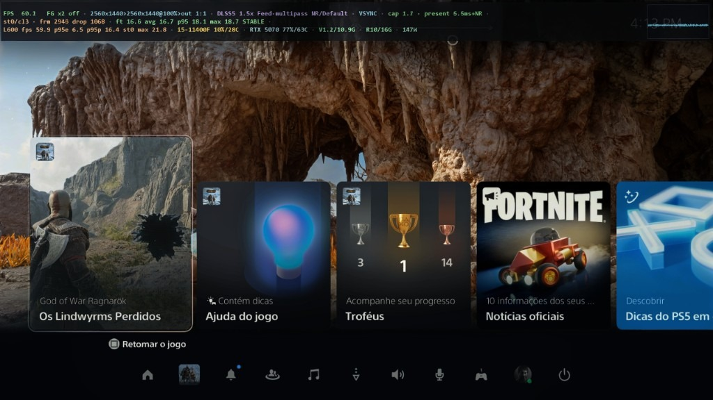
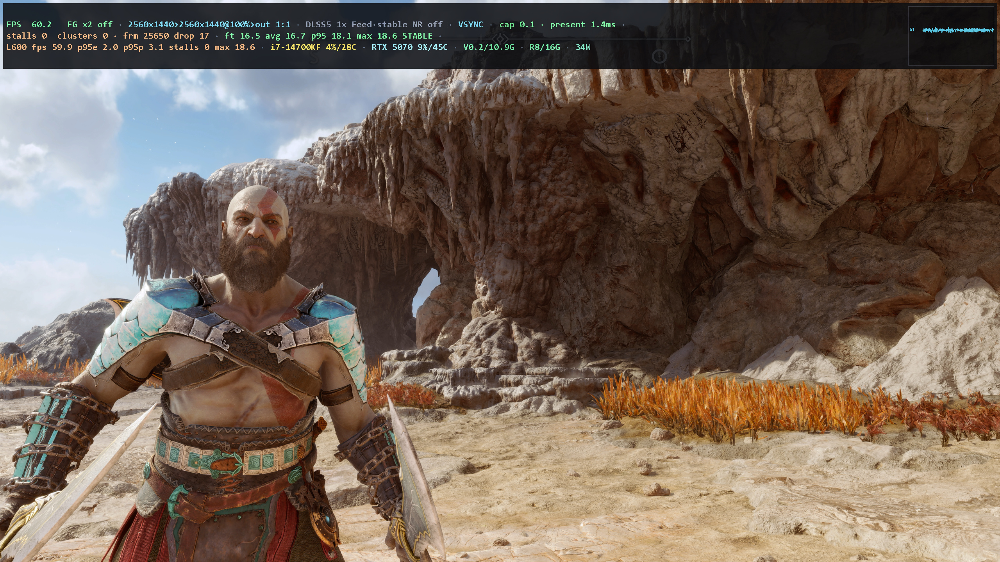
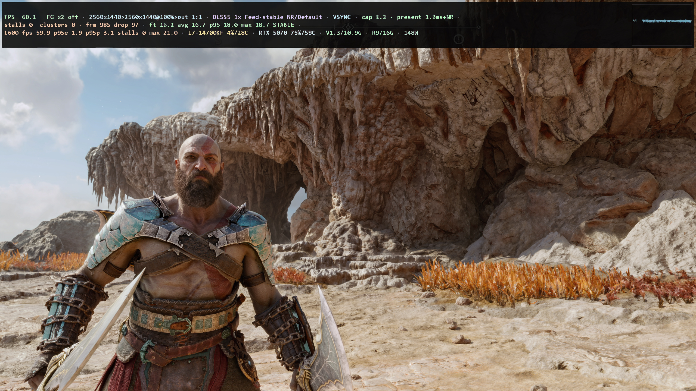
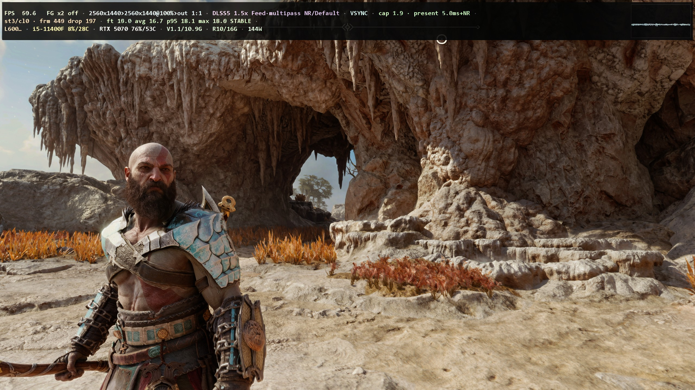
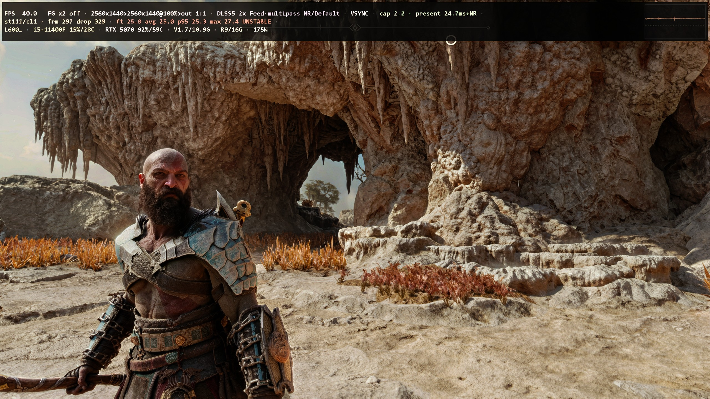
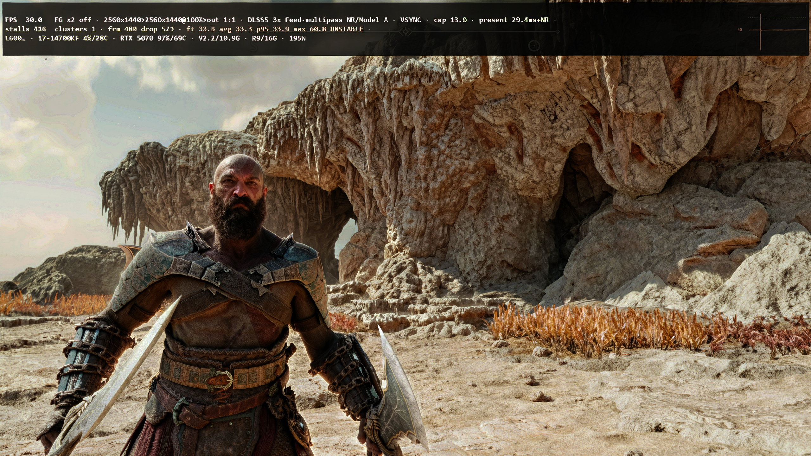
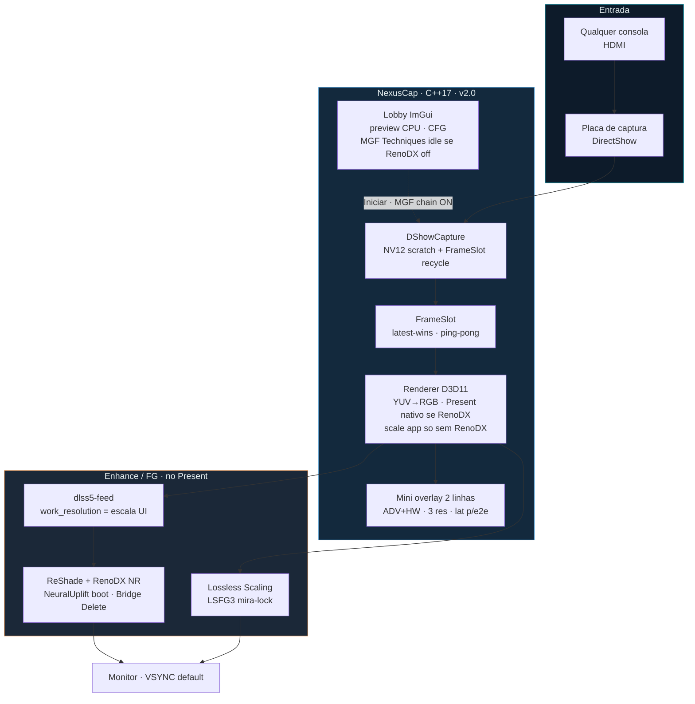

# NexusCap

<p align="center">
  
</p>

**Viewer nativo de captura HDMI** — sinal direto da placa (DirectShow), **DLSS 5 / Neural Rendering** no Present (já no setup), Frame Gen opcional (**Lossless Scaling**), lobby com preview e CFG.

| | |
|---|---|
| **Versão** | `3.1.10` · instalador Inno via `tools\make_installer.ps1` |
| **Repo** | privado — https://github.com/lealvjo/NexusCap |
| **Linguagem** | **C++17** (nativo Windows) |
| **Stack** | CMake · D3D11 · DirectShow · ImGui · WASAPI |
| **Settings / install** | `%LOCALAPPDATA%\NexusCap` (não use Program Files) |

---

## Para a comunidade (download)

Distribua **só** o instalador — sem pasta manual, sem código:

**[NexusCap-Setup-3.1.7.exe](https://github.com/lealvjo/NexusCap/releases)**

O setup **não fica no git**; sobe na **Release** do GitHub.

**O que o usuário final faz:**

1. Instalar `NexusCap-Setup-3.1.7.exe` (vai para `%LOCALAPPDATA%\NexusCap`, **sem admin**).
2. Abrir o app e usar — **RenoDX / Neural Rendering / mini overlay / VSYNC / métricas 2.x já vêm no pacote**.
3. **Só se quiser Frame Gen:** instalar [Lossless Scaling](https://store.steampowered.com/app/993090/Lossless_Scaling/) na Steam (não vem no setup). Page Down no CFG.

Nada mais. Sem copiar DLL avulsa, sem pasta X2.

### Requisitos do usuário final

| Precisa | Detalhe |
|---------|---------|
| **Placa de captura** | HDMI via DirectShow (ex.: VEDO / Elgato / similar) |
| **GPU NVIDIA** | Para RenoDX / Neural Rendering (já embutido no setup) |
| **Windows 64-bit** | Build nativo |
| **Frame Gen (opcional)** | [Lossless Scaling](https://store.steampowered.com/app/993090/Lossless_Scaling/) na Steam — **única** instalação extra |

### Instalador menos invasivo

O setup **não pede administrador** e **não mostra** o UAC (“Deseja permitir que este aplicativo faça alterações no dispositivo?”). Instala na pasta da tua conta — `%LOCALAPPDATA%\NexusCap` — no mesmo espírito do Steam, Discord e Spotify.

Isso **não é menos seguro**. Aquele aviso só aparece quando o programa quer poder no sistema inteiro (`Program Files`, serviços, outras contas). Nós não precisamos disso. Pedir admin só para parecer “oficial” seria **mais perigoso**.

RenoDX / ReShade precisam gravar `ini`, `cfg` e cache **ao lado do exe**. Em Program Files o Windows bloqueia a escrita; presets falham. Por isso o padrão é a pasta do utilizador: menos invasivo, e o enhance funciona.

### Passo a passo de instalação

1. Baixe `NexusCap-Setup-3.1.7.exe` na Release do GitHub.
2. Execute o setup (Instala em `%LOCALAPPDATA%\NexusCap`, sem admin — pasta gravável; RenoDX precisa escrever ini/cfg/cache).
3. Abra **Nexus Cap**, escolha a placa de captura e ajuste no lobby (preview ao vivo + áudio HDMI).
4. Marque **RenoDX** se quiser Neural Rendering (Delete liga/desliga na captura). Com RenoDX, a escala do CFG afeta só o Feed (Present fica nativo — melhor nitidez).
5. **Frame Gen (opcional):** instale Lossless Scaling na Steam; no CFG, Page Down liga/desliga. Se o exe não for achado, use **Pasta** e aponte `LosslessScaling.exe`.
6. **Iniciar** — Esc volta ao lobby. **F12** (ou o botão CFG) abre o painel do menu principal. **Ctrl+M** abre o CFG por cima do jogo (ajusta sem sair da captura) e **Ctrl+Espaço** cicla os overlays HUD (Compact → Mini → Advanced → Live → desliga; o próximo toque recomeça). Os atalhos são configuráveis. Use **Abrir logs** no CFG se precisar de suporte.
7. **Reportar bug / Reportar performance** (checkboxes abaixo do VSYNC, off por padrão): geram `.txt` leves em `report/` e `performance/` ao lado do exe — úteis para suporte / colar numa IA.

**Evite instalar em Program Files** — o Present/RenoDX precisa gravar ao lado do exe.

### Novidades 3.1.10

- **Benchmark não vaza no lobby:** Esc, X ou o fim do teste devolvem escala, Pass, tom, NR e Feed ao HDMI. O Lossless Scaling é encerrado (não vai para a bandeja) e o app relança o lobby limpo.
- **Gráfico com FG off:** só a linha da captura. x2/x3/x4 só aparecem com Frame Gen ligado.

### Novidades 3.1.9

- **Benchmark no lobby:** quem ainda não tem placa corre um clipe no mesmo Present / NR / FG da sessão. O relógio só arranca quando o pipeline escolhido está mesmo ligado.
- **Pino virtual de captura:** cadência 30 ou 60, decode à frente, sem câmera lenta nem seek a chutar o quadro.
- **Conselho estatístico:** escala e Frame Gen saem do fps medido, sem tabela chumbada.
- HDMI real 1440p60 **1x e 1,5x** continuam a ~60 fps com 0 stalls nesta máquina.

### Novidades 3.1.8

- **Overlay no restart:** mudar motor / Pass Count / escala / NR volta para o mesmo overlay da sessão (mini, ADV, live…). O ciclo Ctrl+Espaço continua só na sessão — os checks do lobby não mudam.
- **Frame Gen no gráfico:** x2/x3/x4 desenham uma linha extra por multiplicador, cada uma com cor própria, acima do frametime da captura. Vale também se o console estiver abaixo de 60 fps.
- **Aviso de restart:** “Otimizando o pipeline” no hold do motor, em vez de parecer que o app fechou.

### Novidades 3.1.7

- **HDMI do console, sem susto:** se o Xbox/PS5 para de mandar sinal (entrar/sair do jogo), o Present segura o último frame bom — sem magenta, sem flicker. Um cartão dourado queimado no quadro explica que **foi o console** que cortou o HDMI; o NexusCap está só a limpar o pipeline para quando o sinal voltar.
- **Um cartão por handshake**, ~3 s, e some quando o sinal estabiliza. Delete, NR, preset, Pass Count, escala do Feed e `--autostart` **não** disparam este aviso — isso é restart nosso, não dropout do console. Também não entra toast extra no overlay.

### Novidades 3.1.6

- **HDMI Xbox / consola:** ao entrar ou sair do jogo o ecrã segura o último frame bom (não fica preto nem flicker), deita fora buffers do tamanho errado, e reabre a captura sozinha ~0,5–1 s depois do sinal voltar (Stop/Run + reset do Feed). O modo é o que escolheste no lobby — não está travado em 2560×1440. A retomada ainda pode dar um salto; o próximo passo é deixar isto mais suave.

### Novidades 3.1.5

- **Iniciar aplica o CFG do lobby:** escala, DLSS 5, preset e NR entram na sessão (o Feed/ReShade já não ficam travados no preview).
- **CFG reabre depois do restart no lobby:** troca de Pass Count / motor volta com o painel Configurações aberto.
- **Console no overlay é opcional:** checkbox Mostrar console; marcado, as opções aparecem (padrão PS5), só texto colorido.
- **Mais consolas:** PS5, PS4, PS3, Xbox Series X/S, Xbox One, Switch 2 e Switch.
- **Marca SPIKE** à esquerda do logo N no lobby.
- **Exibir metricas** no HUD; stalls/clusters por extenso no overlay.

### Novidades 3.1.4

- **NR off de verdade em todos os x:** Delete / Ctrl+M desliga NeuralUplift **e** o feed DLSS5 (1x, 1,5x, 2x e 3x). Antes só reiniciava com `feed=ON` e a imagem quase não mudava.

### Novidades 3.1.3

- **F12** abre o CFG do lobby (a tecla já gravava, mas o menu só abria pelo botão).
- **Delete sem RenoDX** avisa para marcar no lobby — já não finge “NR OFF Confirmado”.
- **Smoke / selftest** não apagam o `NeuralUplift` do utilizador.
- Plano BDD em [`qa/bdd/`](qa/bdd/) (Gherkin: lobby, CFG do menu, Ctrl+M, atalhos, distribuição).

### Novidades 3.1.2

- **Preset visual (Default / Natural / Cinematic)** no Ctrl+M grava em **todas** as secções do ReShade (incluindo a viva `[RenoDX.DLSS5]`) e volta para a sessão — vale em 1x, 1,5x, 2x e 3x.
- **Reinício mais curto:** o aviso caiu de 2,2 s para **1,1 s**.

### Novidades 3.1.1

- **NR on/off em todos os modos:** Delete ou Ctrl+M no 1x, 1,5x, 2x e 3x grava e reinicia de volta na sessão (sem pulso ao vivo).
- **Preset visual** também reinicia no 1x — o ciclo OFF→ON invertia a imagem e o check.
- **1,75x removido** (pedia baixar a resolução do Feed).

### Novidades 3.1

- **CFG na captura (`Ctrl+M`):** o menu abre por cima do jogo, com mouse. Frame Gen entra ao vivo. **NR on/off** e o **preset visual** gravam e reiniciam — voltam para a sessão. **Esc** fecha o menu; **Esc** de novo volta ao lobby.
- **Reinício avisado:** mudar o **Pass Count**, o **preset visual**, o **NR**, ou aplicar nova **escala do Feed** reinicia o app — o addon lê essas coisas só no boot. O aviso "Reiniciando o NexusCap" fica na tela durante a contagem, o teardown e o boot do processo novo, e a sessão volta onde estava (nunca no lobby).
- Pitch 3.1: HDMI de qualquer consola, Frame Gen até 4x se o Lossless Scaling estiver na Steam (integra sozinho, perfil de mira/HUD), stills **STABLE** em 1440p.
- Se um modo pesar: escala do Feed (onde o DLSS trabalha) ou modo da placa (o HDMI que ela anuncia). Ex.: placa até 4K30, preferência 2K60.
- Tabela de latência inclui **3x** (~33 ms, ~27 fps). **2x** ~25 ms / ~40 fps. **1,5x** continua o modo justo (~7 ms, ~60 fps).

### Novidades 3.0

- **Pass Count 1x / 1,5x / 2x / 3x:** **1x** e **1,5x** ficam nativos a ~60 fps. **2x / 3x** nativos caem de fps. Escala do Feed continua **manual**.
- **Escala DLSS5 (Feed):** lobby sempre 100% (menus nítidos); escala na captura via reinício; mínimo efetivo 50% no Feed.
- **Overlay:** cadeia captura → trabalho → saída; estado DLSS5 visível.
- **NR on/off:** Delete ou Ctrl+M em qualquer Pass Count (reinicia e volta para a sessão).

### Qualidade e latência (3.0)

- Captura **NV12-first**; rejeita downscale silencioso (ex.: 4K60 → 1080p) — sem fake/tela branca no lobby.
- Lobby lista só modos que anunciam NV12; falha de open volta ao lobby (sem fallback fake).
- Hitch / overlay **STABLE** escalam com o FPS da captura (`25×60/fps`) — sem falso instável em 30 fps.
- **Latência no HUD (qualquer modo · escala/work 100%):**
  - **`present` (+NR/DLSS5)** = processamento no Present **com enhance ligado** — no **1x** ~3,5 ms; no **1,5x** ~7 ms (ainda cabe nos ~16 ms @60).
  - **`cap`** = captura pura no app — tipicamente **~1 ms**.
  - **2x** neste setup saiu a ~40 fps / present ~25 ms; **3x** ~27 fps / present ~33 ms. Por isso o 1,5x é o modo do dia a dia.
- Mini overlay: `cap … · present …ms+NR` · HUD F3: `present … (+NR/DLSS5)`.
- Instalador **Release** sem janela preta de CMD (só GUI). **Sem admin / sem UAC** — pasta do utilizador, menos invasivo.

### Prints (HDMI de qualquer consola · sessão PS5 · God of War · 1440p60 · 100% · VSYNC · FG off)

Sinal HDMI **direto de qualquer consola** (PS5, Xbox, Switch, outro HDMI), sem recapturar o PC. As stills deste pitch são de uma **sessão PS5**. A escada: o que dá para crescer, com desempenho. **1,5x é o modo justo.**

Vês a imagem **direto**: preview no lobby, captura no Present, OBS Game Capture pega o mesmo frame (HUD/mini overlay queimados). No **1x** nativo (100%, VSYNC) o ritmo fica ~59,9 fps, stalls 0, Feed leve.

| | |
|---|---|
| UI da consola no mesmo HDMI (sessão PS5) |  |
| Sem DLSS / NR |  |
| **1x** · 59,9 fps · stalls 0 |  |
| **1,5x** · 59,9 fps · stalls 0 · recomendado |  |
| **2x** · ~40 fps · pesado, pouco ganho |  |
| **3x** · ~27 fps · teto, ainda mais pesado |  |

Pitch em PDF: [`assets/pitch/NexusCap_Pitch.pdf`](assets/pitch/NexusCap_Pitch.pdf)

- 1x e 1,5x: **mesma resolução, mesmo ~60 fps**. O 1,5x fica mais limpo (pele, cenário) sem perder o ritmo.
- 2x e 3x: mais custo, pouco a ganhar, look mais descaracterizado.
- Escala do Feed é escolha **manual** — os modos 1x/1,5x não baixam a res sozinhos.
- Guardrail: mudanças de enhance não devem piorar nitidez nem `present_ms` vs 1.1.7.
- Com RenoDX ligado, escala UI → `work_resolution` do Feed apenas (sem double-downsample no app).
- **VSYNC default** (`Sincronizar imagem`) — TEAR+ALLOW_TEARING ficou mais “tremido” no A/B; Present(1) no Hz do monitor.
- NR no boot confia **NeuralUplift** (sem enable-pulse que invertia OFF).
- Métricas smoke: **120 frames de warmup** (hitch NGX ~2,5 s) fora da janela de 600; regime steady ~**59,9 fps**, `p95_present` ~2,1–2,4 ms.
- **Mini overlay**: 2 linhas · latência `cap` / `present+NR` · FT/L600/HW · 3 resoluções.
- **Preview lobby**: áudio WASAPI. **Desativar preview** / **Desativar som** na faixa. Preview off para a captura HDMI do lobby; Iniciar não muda.
- **Ctrl+Espaço** (default, configurável em Atalhos + checkbox Ctrl): cicla o HUD na sessão (Compact → Mini → Advanced → Live → off → Compact). Não grava os checks do lobby.
- **Reportar bug** → `report/bug_TIMESTAMP.txt` (eventos, hitch, `event=exception` em falhas).
- **Reportar performance** → `performance/performance_TIMESTAMP.txt` (SETUP PC, snapshot RenoDX, TUNABLES, métricas/latência, AI_HINT) — overhead mínimo (heartbeat ~2 s).

---

## Por que existe (vantagem principal)

Muitos viewers “bonitos” **capturam a tela** (ou a janela de outro app) para aplicar filtro/upscale. Isso gera:

- hitch / stutter aleatório (compositor e capturador brigam pelo mesmo frame)
- latência extra (frame → tela → recaptura → filtro → tela de novo)
- ghost / inconsistência quando Frame Gen entra no meio

**NexusCap não faz isso.** Ele lê o **HDMI da placa de captura** e desenha **ele mesmo** em D3D11. O enhance (RenoDX) e o Frame Gen entram **depois**, no Present — uma passagem limpa:

```text
  consola (PS5 / Xbox / Switch / …) ──HDMI──► placa ──DShow──► NexusCap (D3D11 Present)
                                              │
                                              ├─ RenoDX / NR  (opcional)
                                              └─ Lossless FG  (opcional)
```

Resultado: imagem estável, latência previsível, sem o “tranco” clássico de recapturar a própria saída.

---

## Por que C++17

| Vantagem | Na prática |
|----------|------------|
| **Latência baixa** | Sem GC, sem runtime pesado no caminho do frame |
| **Controle total de GPU/API** | D3D11, shaders NV12→RGB, Present sync — no mesmo processo |
| **DirectShow / WASAPI nativos** | Captura e áudio HDMI sem ponte lenta |
| **Determinismo** | Frametime e hitch medidos de verdade (HUD / analyze) |
| **Binário único Release** | `.exe` + DLLs ao lado; fácil de versionar e distribuir em privado |

ImGui é só UI do lobby; o caminho quente (captura → Present) é C++ + D3D11.

---

## Arquitetura (2.0)



### Camadas

```text
┌─────────────────────────────────────────────────────────────┐
│  LOBBY          UI · preview · settings.ini · health/logs   │
├─────────────────────────────────────────────────────────────┤
│  SESSION        hotkeys · Esc→lobby · analyze · avisos      │
├─────────────────────────────────────────────────────────────┤
│  CAPTURE        DirectShow · NV12 · FrameSlot recycle       │
├─────────────────────────────────────────────────────────────┤
│  RENDER         D3D11 decode · Present DXGI (VSYNC default) │
│                 Com RenoDX: Present nativo (sem scale app)  │
├─────────────────────────────────────────────────────────────┤
│  FEED / ENHANCE escala so no Feed · RenoDX/NR · Bridge      │
├─────────────────────────────────────────────────────────────┤
│  FRAME GEN      Lossless Scaling (Steam) · perfil mira-lock │
└─────────────────────────────────────────────────────────────┘
```

**Regra de ouro:** a captura **nunca** olha para o framebuffer já filtrado. Por isso o hitch de “capturar a própria tela” não aparece aqui.

**Contrato de escala (2.0):** com RenoDX, o slider de escala **não** reduz o RT do app (evita double-downsample). Só o Feed recebe `work_resolution`. Sem RenoDX, o scale GPU do renderer continua valendo.

### Comparativo rápido

| Abordagem | Caminho | Risco de hitch |
|-----------|---------|----------------|
| Recapturar tela/janela + filtro | sinal → app A → tela → capturador → app B | alto |
| **DLSS5 MGF X2** | VEDO → app Sobrepor + Feed/NR | baixo (bom), menos telemetria |
| **NexusCap 2.0** | sinal → placa → **um** Present D3D11 (+ Feed/NR/FG) | baixo + métricas 600f / analyze |

---

## O que o programa faz

1. **Lobby** — dispositivo HDMI/webcam, modo (resolução/FPS), formato (NV12…), cor/range, escala, RenoDX/FG na engrenagem (CFG). Preview ao vivo (decode CPU letterbox). Com RenoDX off, Techniques MGF ficam vazias (lobby leve).
2. **Iniciar processamento** — sessão: captura → decode NV12 → Present. Com RenoDX: Present nativo + escala no Feed; sem RenoDX: scale GPU no renderer. Lossless Scaling se FG ligado.
3. **Esc** na sessão volta ao lobby (feed volta a 100%; MGF conforme RenoDX). Esc no lobby **não** fecha o app (só X / Sair).

### O que *não* é

- Não embute Lossless Scaling.
- Preview do lobby **não** passa por RenoDX/NR no ImGui (CPU → textura); o Present do lobby ainda carrega dxgi se o stack estiver ao lado do exe.
- **Streamline não entra no uso normal.** O enhance do app é RenoDX. Com RenoDX ligado o Streamline fica off (HDMI não se dá bem com DLSS nativo de jogo; os dois no mesmo Present ainda processariam duas vezes).

---

## Fluxo do frame (detalhe)

```
Placa HDMI (DShow)
    → FrameSlot (NV12 recycle / latest-wins)
        → Renderer D3D11 (YUV→RGB)
            → Present DXGI  [VSYNC default · TEAR opcional no CFG]
                → dlss5-feed (work_resolution = escala UI)   [se RenoDX]
                → ReShade/RenoDX Neural Rendering            [opcional]
                → Lossless Scaling LSFG3 (mira-lock)         [opcional]
```

- **Com RenoDX:** Present = resolução do sinal; escala só no Feed (`work_resolution`).
- **Sem RenoDX:** escala 25–100% no renderer (trabalho GPU).
- **4K @ 50%** (sem RenoDX) = captura 3840×2160, work ~1920×1080. Mínimo **25%**.
- **4K** ok se a placa listar o modo — sem teto artificial no app.

---

## Lobby e engrenagem (CFG)

| Área | Função |
|------|--------|
| **Dispositivo / Modo** | Combos DirectShow reais (é aqui que se escolhe a placa). |
| **Formato / Cor / Range / Buffer** | Estilo OBS; NV12 + BT.709 + Limitado por default. |
| **Escala** | 25–100% — com RenoDX: só Feed; sem RenoDX: trabalho GPU do app. |
| **Frame Gen** | x2/x3/x4; **Pasta** se o Steam não achar o exe; **Auto** limpa override. |
| **RenoDX / Neural Rendering** | Checkbox + presets Default / Natural / Cinematic; Delete liga/desliga NR. |
| **Sincronizar imagem** | Default **ON** (VSYNC). Off = TEAR / Present livre. |
| **Abrir logs** | Pasta `%LOCALAPPDATA%\NexusCap\logs`. |
| **Atalhos** | Remapeáveis, incluindo o **Menu na captura** (`Ctrl+M`). |

Avisos leves (lobby toast + HUD na sessão): ao **ligar FG**, ao **subir** o multiplicador (2→3→4), e ao **ligar/desligar** Neural Rendering. Na sessão o tip aparece mesmo se o HUD estiver oculto.

---

## Enhance: RenoDX (o que usamos)

O caminho do produto é **RenoDX** — ReShade + addons DLSS 5 no Present, NR via Bridge, presets no CFG. É o que o lobby liga.

**Streamline** (DLSS nativo NVIDIA) ficou no código/instalador como backend antigo (`--enhance streamline`). Não aparece no menu. HDMI não tem vetores de movimento de jogo, então esse caminho é pior; com RenoDX ligado ele **não** roda.

| Backend | No app | Papel |
|---------|--------|--------|
| **RenoDX** | default do CFG (`enhance_renodx`) | Feed + Neural Rendering. **Usamos isto.** |
| **Off** | RenoDX desmarcado | Passthrough + FG se quiser. |
| **Streamline** | só CLI legado | Não usar no HDMI. |

Setup: `tools\setup_renodx.ps1` copia `dxgi.dll`, addons, `nvngx_dlss*.dll`, shaders/preset para ao lado do exe. O `nvngx_dlss.dll` é da NVIDIA para o **RenoDX/DLSS 5**, não é o Streamline.

---

## Frame Gen (Lossless Scaling)

- Instala pelo Steam. Busca: caminho da CFG / `--fg-path` → pasta Steam padrão → registro Steam.
- Perfil **mira-lock**: `LSFGFlowScale=100`, WGC, LSFG3 FIXED, BALANCED (menos ghost na mira).
- Page Down = on/off · Page Up = ciclo x2→x3→x4.

---

## Mapa do código

| Caminho | Papel |
|---------|--------|
| `src/main.cpp` | Sessão, hotkeys, FG/NR, analyze, volta ao lobby |
| `src/lobby_imgui.cpp` | Lobby, preview, CFG, logo, browse FG |
| `src/capture_dshow.cpp` | DirectShow, modos/fourcc |
| `src/capture_fake.cpp` | Smoke/selftest |
| `src/renderer_d3d11.cpp` | Decode, scale, Present, HUD, ícone |
| `src/lossless_fg.cpp` | Resolve LS, mira-lock, Job Object |
| `src/dlss5_bridge.cpp` | Pulse Neural Rendering |
| `src/enhance_dlss_streamline.cpp` | Streamline DLSS (legado, off com RenoDX) |
| `src/enhance_passthrough.cpp` | Sem enhance |
| `src/settings_store.cpp` | `settings.ini` + sync feed/ReShade |
| `src/config.cpp` | CLI + persist → config |
| `src/audio_wasapi.cpp` | Áudio (prefere HDMI) |
| `src/analyze_io.cpp` | JSONL + summary |
| `include/nexuscap/*.hpp` | Contratos e helpers testáveis |
| `tests/test_core.cpp` | Unit (doctest) |
| `resources/nexuscap.rc` | Ícone no `.exe` |
| `assets/logo.png` | Brand |
| `third_party/` | imgui, doctest, Streamline SDK (vendored, não é o enhance do CFG) |
| `tools/setup_renodx.ps1` | Stack RenoDX ao lado do Release |

---

## Build

**Requisitos:** VS 2022 (C++), CMake ≥ 3.20, Windows SDK. NVIDIA recomendada para RenoDX / Neural Rendering.

```bat
cd C:\Users\Leo\Documents\NexusCap
cmake -S . -B build -G "Visual Studio 17 2022" -A x64
cmake --build build --config Release
ctest --test-dir build -C Release --output-on-failure
powershell -ExecutionPolicy Bypass -File tools\setup_renodx.ps1
```

Ou `build.bat`. POST_BUILD copia DLLs NVIDIA (`nvngx` / Streamline legado) + `assets/logo.png` e `assets/watermark.png`. Ícone do exe vem do `.rc`.

---

## Instalador (Inno Setup)

Gera `dist\NexusCap-Setup-<versão>.exe`. **Não inclui Lossless Scaling** (Frame Gen continua opcional via Steam).

**Requisitos extras:** [Inno Setup 6+](https://jrsoftware.org/isinfo.php) (o script pode instalar via winget) e, para embutir RenoDX, a pasta X2 (`C:\Program Files\DLSS5 MGF X2`).

```bat
tools\make_installer.bat
rem ou:
powershell -ExecutionPolicy Bypass -File tools\make_installer.ps1 -Version 3.1.7
powershell -ExecutionPolicy Bypass -File tools\make_installer.ps1 -InstallInno
powershell -ExecutionPolicy Bypass -File tools\make_installer.ps1 -SkipBuild -Version 3.1.7
```

Instala por padrão em `%LOCALAPPDATA%\NexusCap` (`PrivilegesRequired=lowest` no Inno — **sem UAC / sem admin**). É menos invasivo de propósito: o setup não mexe no sistema. **Evite Program Files** — RenoDX precisa gravar ini/cfg/cache ao lado do exe.

| Peça | Caminho |
|------|---------|
| Script Inno | `packaging/NexusCap.iss` |
| Stage limpo | `dist/stage/` |
| Aviso LS | `packaging/NOTICE.txt` (wizard + pasta do app) |
| Saída | `dist/NexusCap-Setup-*.exe` |

Desinstalação remove o app; **não** apaga `%LOCALAPPDATA%\NexusCap\settings.ini`.

---

## Uso

```bat
build\Release\NexusCap.exe
build\Release\NexusCap.exe --renodx --no-lobby
build\Release\NexusCap.exe --renodx --fg-x 2 --no-lobby
build\Release\NexusCap.exe --scale 50 --no-lobby
build\Release\NexusCap.exe --smoke --frames 120
build\Release\NexusCap.exe --selftest-fg --fake-capture
```

### CLI

| Flag | Efeito |
|------|--------|
| `--no-lobby` | Direto à sessão |
| `--renodx` / `--enhance renodx\|off` | Backend do produto (RenoDX) |
| `--enhance streamline` / `--dlss` / `--dlss-mode …` | Legado Streamline — não usar no HDMI |
| `--fg-x 1\|2\|3\|4` | FG (1 = off) |
| `--fg-path <exe>` | Override Lossless Scaling |
| `--scale 25–100` | Trabalho GPU |
| `--device <nome>` | Filtro dispositivo |
| `--windowed` | Janela |
| `--smoke` / `--frames N` / `--fake-capture` | Testes |
| `--selftest-cap` / `--selftest-dlss` / `--selftest-fg` / `--selftest-cfg` | Selftests |

### Hotkeys padrão (CFG remapeia)

| Tecla | Ação |
|-------|------|
| Esc | CFG aberto → fecha o menu; sem menu, sessão → lobby |
| Ctrl+M | CFG na captura (por cima do jogo) |
| F3 | HUD |
| F4 | Analyze |
| F5 | Streamline DLSS (legado; com RenoDX não faz nada) |
| Page Down | FG on/off |
| Page Up | Ciclo FG |
| Home | Overlay RenoDX |
| Delete | Neural Rendering on/off |
| F11 | Fullscreen ↔ janela |
| F12 | CFG no lobby |

---

## Persistência e logs

- Settings: `%LOCALAPPDATA%\NexusCap\settings.ini`
- FG mira-lock: `%LOCALAPPDATA%\Lossless Scaling\Settings.xml`
- Logs: `logs\` (`nexuscap.log`, summary, JSONL do analyze)

---

## Testes

```bat
ctest --test-dir build -C Release --output-on-failure
build\Release\nexuscap_tests.exe
```

`ctest` corre unitários + smokes + `--selftest-fg` / `--selftest-cfg`. Smoke e selftest **não** apagam o NeuralUplift do utilizador.

BDD (Gherkin, HDMI à mão): [`qa/bdd/`](qa/bdd/) — ordem no `README` dessa pasta. `@critico` é porta de release. `@auto` = já coberto pelo `ctest`.

Unitários cobrem CLI, escala, mira-lock, Esc/WM_QUIT no lobby, F12 do CFG, Bridge NR, formato/cor, letterbox, avisos FG/NR, `settings.ini`.

---

## Terceiros

imgui · doctest · NVIDIA nvngx (RenoDX/DLSS 5) · RenoDX/ReShade/feed (via setup) · Lossless Scaling (Steam do usuário). Streamline SDK fica vendored/legado e não entra no fluxo do CFG.
