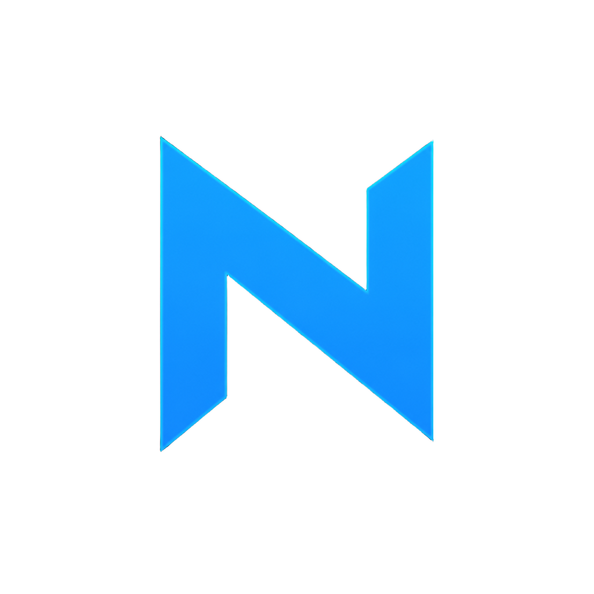
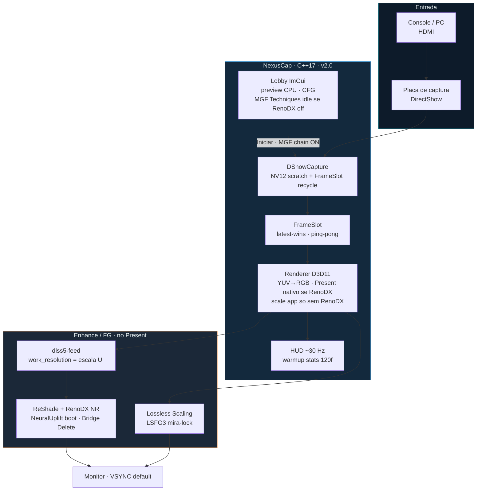

# NexusCap

<p align="center">
  
</p>

**Viewer nativo de captura HDMI** — sinal direto da placa (DirectShow), enhance no Present (**RenoDX / Neural Rendering**), Frame Gen opcional (**Lossless Scaling**), lobby com preview e CFG.

| | |
|---|---|
| **Versão** | `2.0.1` · instalador Inno via `tools\make_installer.ps1` |
| **Repo** | privado — https://github.com/lealvjo/NexusCap |
| **Linguagem** | **C++17** (nativo Windows) |
| **Stack** | CMake · D3D11 · DirectShow · ImGui · WASAPI |
| **Settings / install** | `%LOCALAPPDATA%\NexusCap` (não use Program Files) |

---

## Para a comunidade (download)

Distribua só o instalador — **não** precisa mandar pasta `manual` nem o código:

**[NexusCap-Setup-2.0.1.exe](https://github.com/lealvjo/NexusCap/releases)** (gere com `tools\make_installer.ps1`)

O `.exe` do setup **não fica no git** (é grande demais); fica na **Release** do GitHub.

### Requisitos do usuário final

| Precisa | Detalhe |
|---------|---------|
| **Placa de captura** | HDMI via DirectShow (ex.: VEDO / Elgato / similar) |
| **GPU NVIDIA** | Para RenoDX / Neural Rendering (ReShade + DLSS NR) |
| **Windows 64-bit** | Build nativo |
| **Frame Gen (opcional)** | Instalar [Lossless Scaling](https://store.steampowered.com/app/993090/Lossless_Scaling/) na Steam — **não** vem no instalador |

### Passo a passo de instalação

1. Baixe `NexusCap-Setup-2.0.1.exe` na Release do GitHub.
2. Execute o setup (Instala em `%LOCALAPPDATA%\NexusCap` — pasta gravável; RenoDX precisa escrever ini/cfg/cache).
3. Abra **Nexus Cap**, escolha a placa de captura e ajuste no lobby (preview ao vivo).
4. Marque **RenoDX** se quiser Neural Rendering (Delete liga/desliga na captura). Com RenoDX, a escala do CFG afeta só o Feed (Present fica nativo — melhor nitidez).
5. **Frame Gen (opcional):** instale Lossless Scaling na Steam; no CFG, Page Down liga/desliga. Se o exe não for achado, use **Pasta** e aponte `LosslessScaling.exe`.
6. **Iniciar** — Esc volta ao lobby. Use **Abrir logs** no CFG se precisar de suporte.

**Evite instalar em Program Files** — o Present/RenoDX precisa gravar ao lado do exe.

### Qualidade e latência (2.0.1)

- Stack enhance: **Krish `renodx-dlss5` + Feed + Bridge** (não usar builds ShortFuse / “super-anus”).
- Guardrail: mudanças de enhance não devem piorar nitidez nem `present_ms` vs 1.1.7.
- Com RenoDX ligado, escala UI → `work_resolution` do Feed apenas (sem double-downsample no app).
- **VSYNC default** (`Sincronizar imagem`) — TEAR+ALLOW_TEARING ficou mais “tremido” no A/B; Present(1) no Hz do monitor.
- NR no boot confia **NeuralUplift** (sem enable-pulse que invertia OFF).
- Métricas smoke: **120 frames de warmup** (hitch NGX ~2,5 s) fora da janela de 600; regime steady ~**59,9 fps**, `p95_present` ~2,1–2,4 ms.

---

## Por que existe (vantagem principal)

Muitos viewers “bonitos” **capturam a tela** (ou a janela de outro app) para aplicar filtro/upscale. Isso gera:

- hitch / stutter aleatório (compositor e capturador brigam pelo mesmo frame)
- latência extra (frame → tela → recaptura → filtro → tela de novo)
- ghost / inconsistência quando Frame Gen entra no meio

**NexusCap não faz isso.** Ele lê o **HDMI da placa de captura** e desenha **ele mesmo** em D3D11. O enhance (RenoDX) e o Frame Gen entram **depois**, no Present — uma passagem limpa:

```text
  console / PC ──HDMI──► placa ──DShow──► NexusCap (D3D11 Present)
                                              │
                                              ├─ RenoDX / NR  (opcional)
                                              └─ Lossless FG  (opcional)
```

Resultado: imagem estável, latência previsível, sem o “tranco” clássico de recapturar a própria saída.

---

## Por que C++17

| Vantagem | Na prática |
|----------|------------|
| **Latência baixa** | Sem GC, sem runtime pesado no caminho do frame |
| **Controle total de GPU/API** | D3D11, shaders NV12→RGB, Present sync — no mesmo processo |
| **DirectShow / WASAPI nativos** | Captura e áudio HDMI sem ponte lenta |
| **Determinismo** | Frametime e hitch medidos de verdade (HUD / analyze) |
| **Binário único Release** | `.exe` + DLLs ao lado; fácil de versionar e distribuir em privado |

ImGui é só UI do lobby; o caminho quente (captura → Present) é C++ + D3D11.

---

## Arquitetura (2.0)



### Camadas

```text
┌─────────────────────────────────────────────────────────────┐
│  LOBBY          UI · preview · settings.ini · health/logs   │
├─────────────────────────────────────────────────────────────┤
│  SESSION        hotkeys · Esc→lobby · analyze · avisos      │
├─────────────────────────────────────────────────────────────┤
│  CAPTURE        DirectShow · NV12 · FrameSlot recycle       │
├─────────────────────────────────────────────────────────────┤
│  RENDER         D3D11 decode · Present DXGI (VSYNC default) │
│                 Com RenoDX: Present nativo (sem scale app)  │
├─────────────────────────────────────────────────────────────┤
│  FEED / ENHANCE escala so no Feed · RenoDX/NR · Bridge      │
├─────────────────────────────────────────────────────────────┤
│  FRAME GEN      Lossless Scaling (Steam) · perfil mira-lock │
└─────────────────────────────────────────────────────────────┘
```

**Regra de ouro:** a captura **nunca** olha para o framebuffer já filtrado. Por isso o hitch de “capturar a própria tela” não aparece aqui.

**Contrato de escala (2.0):** com RenoDX, o slider de escala **não** reduz o RT do app (evita double-downsample). Só o Feed recebe `work_resolution`. Sem RenoDX, o scale GPU do renderer continua valendo.

### Comparativo rápido

| Abordagem | Caminho | Risco de hitch |
|-----------|---------|----------------|
| Recapturar tela/janela + filtro | sinal → app A → tela → capturador → app B | alto |
| **DLSS5 MGF X2** | VEDO → app Sobrepor + Feed/NR | baixo (bom), menos telemetria |
| **NexusCap 2.0** | sinal → placa → **um** Present D3D11 (+ Feed/NR/FG) | baixo + métricas 600f / analyze |

---

## O que o programa faz

1. **Lobby** — dispositivo HDMI/webcam, modo (resolução/FPS), formato (NV12…), cor/range, escala, RenoDX/FG na engrenagem (CFG). Preview ao vivo (decode CPU letterbox). Com RenoDX off, Techniques MGF ficam vazias (lobby leve).
2. **Iniciar processamento** — sessão: captura → decode NV12 → Present. Com RenoDX: Present nativo + escala no Feed; sem RenoDX: scale GPU no renderer. Lossless Scaling se FG ligado.
3. **Esc** na sessão volta ao lobby (feed volta a 100%; MGF conforme RenoDX). Esc no lobby **não** fecha o app (só X / Sair).

### O que *não* é

- Não embute Lossless Scaling.
- Preview do lobby **não** passa por RenoDX/NR no ImGui (CPU → textura); o Present do lobby ainda carrega dxgi se o stack estiver ao lado do exe.
- Com RenoDX ligado, Streamline fica off (sem processar duas vezes).

---

## Fluxo do frame (detalhe)

```
Placa HDMI (DShow)
    → FrameSlot (NV12 recycle / latest-wins)
        → Renderer D3D11 (YUV→RGB)
            → Present DXGI  [VSYNC default · TEAR opcional no CFG]
                → dlss5-feed (work_resolution = escala UI)   [se RenoDX]
                → ReShade/RenoDX Neural Rendering            [opcional]
                → Lossless Scaling LSFG3 (mira-lock)         [opcional]
```

- **Com RenoDX:** Present = resolução do sinal; escala só no Feed (`work_resolution`).
- **Sem RenoDX:** escala 25–100% no renderer (trabalho GPU).
- **4K @ 50%** (sem RenoDX) = captura 3840×2160, work ~1920×1080. Mínimo **25%**.
- **4K** ok se a placa listar o modo — sem teto artificial no app.

---

## Lobby e engrenagem (CFG)

| Área | Função |
|------|--------|
| **Dispositivo / Modo** | Combos DirectShow reais (é aqui que se escolhe a placa). |
| **Formato / Cor / Range / Buffer** | Estilo OBS; NV12 + BT.709 + Limitado por default. |
| **Escala** | 25–100% — com RenoDX: só Feed; sem RenoDX: trabalho GPU do app. |
| **Frame Gen** | x2/x3/x4; **Pasta** se o Steam não achar o exe; **Auto** limpa override. |
| **RenoDX / Neural Rendering** | Checkbox + presets Default / Natural / Cinematic; Delete liga/desliga NR. |
| **Sincronizar imagem** | Default **ON** (VSYNC). Off = TEAR / Present livre. |
| **Abrir logs** | Pasta `%LOCALAPPDATA%\NexusCap\logs`. |
| **Atalhos** | Remapeáveis. |

Avisos leves (lobby toast + HUD na sessão): ao **ligar FG**, ao **subir** o multiplicador (2→3→4), e ao **ligar/desligar** Neural Rendering. Na sessão o tip aparece mesmo se o HUD estiver oculto.

---

## Enhance: RenoDX vs Streamline

| Backend | Quando | O que faz |
|---------|--------|-----------|
| **RenoDX** (default CFG) | `enhance_renodx` | ReShade + addons DLSS5; NR via Bridge. |
| **Streamline** | `--enhance streamline` | DLSS nativo; para HDMI prefira **DLAA**. |
| **Off** | sem RenoDX | Passthrough + FG se quiser. |

Setup: `tools\setup_renodx.ps1` copia `dxgi.dll`, addons, `nvngx_dlss*.dll`, shaders/preset para ao lado do exe.

---

## Frame Gen (Lossless Scaling)

- Instala pelo Steam. Busca: caminho da CFG / `--fg-path` → pasta Steam padrão → registro Steam.
- Perfil **mira-lock**: `LSFGFlowScale=100`, WGC, LSFG3 FIXED, BALANCED (menos ghost na mira).
- Page Down = on/off · Page Up = ciclo x2→x3→x4.

---

## Mapa do código

| Caminho | Papel |
|---------|--------|
| `src/main.cpp` | Sessão, hotkeys, FG/NR, analyze, volta ao lobby |
| `src/lobby_imgui.cpp` | Lobby, preview, CFG, logo, browse FG |
| `src/capture_dshow.cpp` | DirectShow, modos/fourcc |
| `src/capture_fake.cpp` | Smoke/selftest |
| `src/renderer_d3d11.cpp` | Decode, scale, Present, HUD, ícone |
| `src/lossless_fg.cpp` | Resolve LS, mira-lock, Job Object |
| `src/dlss5_bridge.cpp` | Pulse Neural Rendering |
| `src/enhance_dlss_streamline.cpp` | Streamline DLSS |
| `src/enhance_passthrough.cpp` | Sem enhance |
| `src/settings_store.cpp` | `settings.ini` + sync feed/ReShade |
| `src/config.cpp` | CLI + persist → config |
| `src/audio_wasapi.cpp` | Áudio (prefere HDMI) |
| `src/analyze_io.cpp` | JSONL + summary |
| `include/nexuscap/*.hpp` | Contratos e helpers testáveis |
| `tests/test_core.cpp` | Unit (doctest) |
| `resources/nexuscap.rc` | Ícone no `.exe` |
| `assets/logo.png` | Brand |
| `third_party/` | imgui, doctest, Streamline SDK |
| `tools/setup_renodx.ps1` | Stack RenoDX ao lado do Release |

---

## Build

**Requisitos:** VS 2022 (C++), CMake ≥ 3.20, Windows SDK. NVIDIA recomendada para RenoDX/Streamline.

```bat
cd C:\Users\Leo\Documents\NexusCap
cmake -S . -B build -G "Visual Studio 17 2022" -A x64
cmake --build build --config Release
ctest --test-dir build -C Release --output-on-failure
powershell -ExecutionPolicy Bypass -File tools\setup_renodx.ps1
```

Ou `build.bat`. POST_BUILD copia Streamline + `assets/logo.png`. Ícone do exe vem do `.rc`.

---

## Instalador (Inno Setup)

Gera `dist\NexusCap-Setup-<versão>.exe`. **Não inclui Lossless Scaling** (Frame Gen continua opcional via Steam).

**Requisitos extras:** [Inno Setup 6+](https://jrsoftware.org/isinfo.php) (o script pode instalar via winget) e, para embutir RenoDX, a pasta X2 (`C:\Program Files\DLSS5 MGF X2`).

```bat
tools\make_installer.bat
rem ou:
powershell -ExecutionPolicy Bypass -File tools\make_installer.ps1 -Version 2.0.1
powershell -ExecutionPolicy Bypass -File tools\make_installer.ps1 -InstallInno
powershell -ExecutionPolicy Bypass -File tools\make_installer.ps1 -SkipBuild -Version 2.0.1
```

Instala por padrão em `%LOCALAPPDATA%\NexusCap` (gravável). **Evite Program Files** — RenoDX precisa gravar ini/cfg/cache ao lado do exe.

| Peça | Caminho |
|------|---------|
| Script Inno | `packaging/NexusCap.iss` |
| Stage limpo | `dist/stage/` |
| Aviso LS | `packaging/NOTICE.txt` (wizard + pasta do app) |
| Saída | `dist/NexusCap-Setup-*.exe` |

Desinstalação remove o app; **não** apaga `%LOCALAPPDATA%\NexusCap\settings.ini`.

---

## Uso

```bat
build\Release\NexusCap.exe
build\Release\NexusCap.exe --renodx --no-lobby
build\Release\NexusCap.exe --renodx --fg-x 2 --no-lobby
build\Release\NexusCap.exe --scale 50 --no-lobby
build\Release\NexusCap.exe --smoke --frames 120
build\Release\NexusCap.exe --selftest-fg --fake-capture
```

### CLI

| Flag | Efeito |
|------|--------|
| `--no-lobby` | Direto à sessão |
| `--renodx` / `--enhance renodx\|streamline\|off` | Backend |
| `--dlss` / `--dlss-mode dlaa\|quality\|…` | Streamline |
| `--fg-x 1\|2\|3\|4` | FG (1 = off) |
| `--fg-path <exe>` | Override Lossless Scaling |
| `--scale 25–100` | Trabalho GPU |
| `--device <nome>` | Filtro dispositivo |
| `--windowed` | Janela |
| `--smoke` / `--frames N` / `--fake-capture` | Testes |
| `--selftest-cap` / `--selftest-dlss` / `--selftest-fg` | Selftests |

### Hotkeys padrão (CFG remapeia)

| Tecla | Ação |
|-------|------|
| Esc | Sessão → lobby |
| F3 | HUD |
| F4 | Analyze |
| F5 | Streamline DLSS (se não for RenoDX) |
| Page Down | FG on/off |
| Page Up | Ciclo FG |
| Home | Overlay RenoDX |
| Delete | Neural Rendering on/off |
| F11 | Fullscreen ↔ janela |
| F12 | CFG no lobby |

---

## Persistência e logs

- Settings: `%LOCALAPPDATA%\NexusCap\settings.ini`
- FG mira-lock: `%LOCALAPPDATA%\Lossless Scaling\Settings.xml`
- Logs: `logs\` (`nexuscap.log`, summary, JSONL do analyze)

---

## Testes

```bat
ctest --test-dir build -C Release -R unit --output-on-failure
build\Release\nexuscap_tests.exe
```

Cobrem CLI, escala 25–100, mira-lock, Esc/WM_QUIT no lobby, Bridge NR, formato/cor, letterbox, logo, avisos FG/NR, `settings.ini`.

---

## Terceiros

imgui · doctest · NVIDIA Streamline/nvngx · RenoDX/ReShade/feed (via setup) · Lossless Scaling (Steam do usuário).
